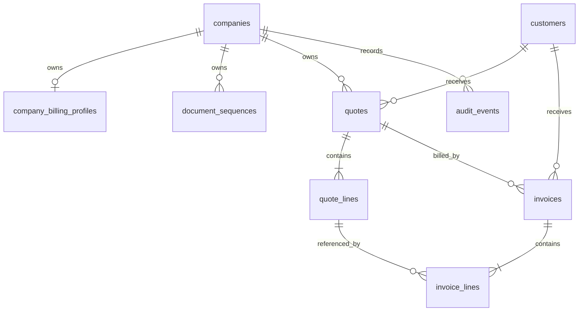

# Modèle de données proposé — Devis et factures

**Statut :** conception logique, non exécutable directement  
**Dépendances :** tables `companies`, `users`, `company_memberships`, `customers`, fonctions `app.has_permission` et `app.log_event`  
**Règle :** aucune migration n'est incluse dans ce document ; le schéma devra être revu et testé avant son application.

## 1. Principes de conception

1. Toute donnée commerciale appartient à une entreprise via `company_id`.
2. L'identifiant de l'entreprise est conservé dans les clés étrangères et index utiles pour rendre les erreurs de tenant impossibles à valider.
3. Les documents envoyés/émis contiennent des snapshots des parties, des lignes, de la devise, des taxes et des totaux. Une modification ultérieure de la fiche client ne réécrit jamais l'historique. Les brouillons peuvent être annulés, mais les documents ne sont pas supprimés définitivement depuis l'interface.
4. Tous les montants sont stockés en types décimaux ; aucun calcul financier n'utilise `float` ou `double precision`.
5. Les numéros sont attribués par une opération transactionnelle, avec verrouillage du compteur.
6. Les brouillons sont éditables ; les documents transmis ou émis sont figés.
7. Les transitions, calculs définitifs, allocations au devis et numérotations passent par des fonctions contrôlées côté serveur/base.
8. RLS et privilèges minimaux s'appliquent à chaque table exposée.

## 2. Vue relationnelle

Le lien entre factures et paiements sera ajouté dans le module Encaissements. Il n'est pas créé dans cette tranche.

## 3. Tables à créer

### 3.1 `company_billing_profiles`

Une ligne par entreprise pour les informations complémentaires de l'émetteur. La raison sociale et le nom commercial restent issus de `companies`.

| Colonne | Type proposé | Règle |
|---|---|---|
| `company_id` | uuid | PK et FK vers `companies.id`, suppression restreinte |
| `tax_identifier` | text nullable | Identifiant fiscal de l'entreprise |
| `tax_regime_code` | text nullable | Régime fiscal vérifié : `CME`, `RSI`, `RNI`, `CSE`, `RND` ou autre code documenté ; ne pas le déduire uniquement du chiffre d'affaires |
| `vat_collection_status` | text | `not_authorized`, `authorized_rni`, `authorized_by_option`, `special_case_to_validate` |
| `vat_authorization_reference` | text nullable | Référence de la décision/option ou pièce justificative si applicable |
| `vat_effective_from`, `vat_effective_to` | date nullable | Période pendant laquelle l'autorisation TVA est effective |
| `tax_profile_verified_at` | timestamptz nullable | Date de vérification du profil fiscal |
| `tax_profile_verified_by` | uuid nullable | Membre ayant enregistré la vérification |
| `address` | text nullable | Adresse à afficher |
| `city` | text nullable | Ville |
| `postal_code` | text nullable | Code postal si applicable |
| `country_code` | char(2) | Code ISO, cohérent avec l'entreprise |
| `email` | text nullable | Contact commercial |
| `phone` | text nullable | Téléphone |
| `payment_instructions` | text nullable | Instructions affichables sur le document |
| `document_footer` | text nullable | Pied de document / mentions complémentaires |
| `updated_by` | uuid nullable | FK vers `users.id` |
| `created_at`, `updated_at` | timestamptz | Horodatage |

**Règle fiscale Burkina Faso :** le profil enregistre le régime confirmé par l'entreprise/conseil fiscal et l'autorisation effective de facturer la TVA. Pour la règle générale publiée par la DGI, le RNI (CA annuel HT égal ou supérieur à 50 millions FCFA) est habilité à facturer la TVA ; le RSI (15 à moins de 50 millions) et la CME (moins de 15 millions) ne le sont pas. Le RSI peut toutefois demander l'option pour le RNI, sous conditions et après acceptation. Les cas particuliers doivent être vérifiés, pas inférés automatiquement.

**Accès proposé :** lecture aux membres disposant de `company:read`, modification aux membres disposant de `company:update`. RLS obligatoire. Les changements de régime/autorisation doivent être datés et audités. Les secrets bancaires ou moyens de paiement sensibles ne sont pas stockés dans ce profil. Référence : [DGI — Régimes d'imposition](https://dgi.bf/regime_imposition/).

### 3.2 `document_sequences`

Compteur atomique par entreprise, type de document et période de numérotation.

| Colonne | Type proposé | Règle |
|---|---|---|
| `company_id` | uuid | FK `companies.id` |
| `document_type` | text | `quote` ou `invoice` |
| `period_key` | text nullable | Segmentation uniquement si le format de série est validé ; ne signifie pas un redémarrage automatique à chaque année civile ou exercice |
| `prefix` | text | Préfixe de série |
| `next_number` | bigint | Prochain numéro strictement positif |
| `padding` | smallint | Largeur minimale du compteur |
| `updated_at` | timestamptz | Dernière réservation |

Clé primaire : `(company_id, document_type, period_key)`.

**Accès :** aucune lecture/écriture directe depuis le client authentifié. Une fonction dédiée réserve le numéro sous verrou transactionnel, puis retourne la valeur formatée. Un numéro utilisé ne doit jamais être réattribué ; les trous de séquence ne doivent pas provoquer de réutilisation. La série légale doit rester vérifiable et ininterrompue ; format, séries par établissement et périodicité doivent être validés localement avant tout redémarrage de compteur.

### 3.3 `quotes`

En-tête des devis.

| Colonne | Type proposé | Règle |
|---|---|---|
| `id` | uuid | PK |
| `company_id` | uuid | FK tenant |
| `customer_id` | uuid | Client de la même entreprise |
| `quote_number` | text nullable | Null en brouillon non transmis ; unique par entreprise lorsqu'il existe |
| `status` | text | `draft`, `sent`, `accepted`, `rejected`, `cancelled` |
| `issue_date` | date | Date du devis |
| `valid_until` | date | Date limite, >= date d'émission |
| `currency_code` | char(3) | Devise figée à partir de l'entreprise |
| `subject` | text nullable | Objet |
| `customer_snapshot` | jsonb | Coordonnées client figées à la transmission |
| `issuer_snapshot` | jsonb | Identité émetteur, régime fiscal et statut TVA effectif figés à la transmission |
| `terms` | text nullable | Conditions du devis |
| `notes` | text nullable | Note non contractuelle selon règle d'affichage |
| `subtotal_amount` | numeric(20,4) | Somme avant remises |
| `discount_amount` | numeric(20,4) | Remises totales de lignes |
| `tax_amount` | numeric(20,4) | Total taxes |
| `total_amount` | numeric(20,4) | Total final |
| `sent_at` | timestamptz nullable | Transmission |
| `accepted_at` | timestamptz nullable | Acceptation client enregistrée |
| `accepted_by` | uuid nullable | Utilisateur ayant saisi l'acceptation |
| `acceptance_method` | text nullable | E-mail, document signé hors ligne, verbal, autre |
| `acceptance_reference` | text nullable | Référence ou note de preuve |
| `rejected_at` | timestamptz nullable | Refus |
| `rejected_by` | uuid nullable | Utilisateur ayant saisi le refus |
| `cancelled_at` | timestamptz nullable | Annulation |
| `cancelled_by` | uuid nullable | Acteur |
| `cancellation_reason` | text nullable | Motif requis |
| `created_by`, `updated_by` | uuid nullable | Acteurs |
| `created_at`, `updated_at` | timestamptz | Horodatage |

Contraintes proposées :
- `UNIQUE(company_id, quote_number)`.
- `UNIQUE(company_id, id)` pour les références composites.
- `UNIQUE(company_id, id, customer_id)` pour valider la cohérence client sur une facture dérivée.
- FK composite `(company_id, customer_id) -> customers(company_id, id)`. La migration doit donc ajouter une contrainte unique explicite sur `customers(company_id, id)`, l'identifiant primaire actuel seul ne suffit pas pour cette FK composite.
- Vérifier dates, montants positifs ou nuls selon l'état, validité de la devise et cohérence des timestamps/statuts.
- Les snapshots sont nullables en brouillon si besoin, puis obligatoires et validés à la transmission.
- Les champs d'acceptation/refus/annulation sont cohérents avec le statut.

Index : `(company_id, status, issue_date desc)`, `(company_id, customer_id, issue_date desc)`, unicité du numéro.

### 3.4 `quote_lines`

Lignes de devis ; elles représentent les éléments du prix accepté.

| Colonne | Type proposé | Règle |
|---|---|---|
| `id` | uuid | PK |
| `company_id` | uuid | Tenant |
| `quote_id` | uuid | Devis parent |
| `position` | integer | Ordre d'affichage, unique par devis |
| `description` | text | Description figée |
| `quantity` | numeric(18,4) | Strictement positive |
| `unit_label` | text | Unité (heure, jour, pièce, forfait, etc.) |
| `unit_price` | numeric(20,4) | Prix unitaire >= 0 |
| `discount_type` | text | `none`, `percentage`, `fixed` |
| `discount_value` | numeric(20,4) | Non négatif, borné par la base de ligne |
| `tax_label` | text nullable | Libellé de taxe figé |
| `tax_rate` | numeric(9,6) nullable | Taux en pourcentage ; valeur configurée, jamais codée en dur ici |
| `base_amount` | numeric(20,4) | Quantité × prix avant remise |
| `discount_amount` | numeric(20,4) | Remise calculée |
| `taxable_amount` | numeric(20,4) | Base après remise |
| `tax_amount` | numeric(20,4) | Taxe calculée |
| `total_amount` | numeric(20,4) | Total de ligne |
| `created_at` | timestamptz | Horodatage |

Clé/FK : `UNIQUE(company_id, quote_id, id)`, FK `(company_id, quote_id) -> quotes(company_id, id)`. Un devis transmis ne peut plus modifier ses lignes.

Index : `(company_id, quote_id, position)`.

V1 : une taxe par ligne et remises de ligne. Les taxes multiples et remises globales nécessiteront une extension dédiée après validation du besoin.

### 3.5 `invoices`

En-tête des factures autonomes ou issues d'un devis.

| Colonne | Type proposé | Règle |
|---|---|---|
| `id` | uuid | PK |
| `company_id` | uuid | Tenant |
| `customer_id` | uuid | Client de la même entreprise |
| `source_quote_id` | uuid nullable | Devis source, si applicable |
| `invoice_number` | text nullable | Null en brouillon ; unique par entreprise après émission |
| `status` | text | `draft`, `issued`, `cancelled` |
| `billing_kind` | text | `standalone`, `full`, `deposit`, `progress`, `final` |
| `issue_date` | date | Date de facture |
| `due_date` | date nullable | Échéance |
| `currency_code` | char(3) | Devise figée |
| `customer_snapshot` | jsonb | Client figé à l'émission |
| `issuer_snapshot` | jsonb | Émetteur, régime fiscal et statut TVA effectif figés à l'émission |
| `subject` | text nullable | Objet |
| `terms` | text nullable | Conditions |
| `notes` | text nullable | Note d'affichage |
| `subtotal_amount` | numeric(20,4) | Sous-total |
| `discount_amount` | numeric(20,4) | Remises |
| `tax_amount` | numeric(20,4) | Taxes |
| `total_amount` | numeric(20,4) | Total de facture |
| `quote_allocated_amount` | numeric(20,4) nullable | Tranche imputée au devis ; obligatoire à l'émission si facture issue d'un devis |
| `issued_at` | timestamptz nullable | Horodatage d'émission |
| `issued_by` | uuid nullable | Acteur |
| `cancelled_at` | timestamptz nullable | Annulation |
| `cancelled_by` | uuid nullable | Acteur |
| `cancellation_reason` | text nullable | Motif obligatoire |
| `created_by`, `updated_by` | uuid nullable | Acteurs |
| `created_at`, `updated_at` | timestamptz | Horodatage |

Contraintes proposées :
- `UNIQUE(company_id, invoice_number)`.
- `UNIQUE(company_id, id)` et `UNIQUE(company_id, id, source_quote_id)` pour les FKs des lignes.
- FK composite `(company_id, customer_id) -> customers(company_id, id)).
- FK composite `(company_id, source_quote_id, customer_id) -> quotes(company_id, id, customer_id)` pour garantir que la facture reprend le client du devis source.
- `billing_kind = standalone` lorsque `source_quote_id IS NULL) ; une facture liée à un devis doit avoir un type `full`, `deposit`, `progress` ou `final`.
- `quote_allocated_amount` est null pour une facture autonome. Pour une facture émise issue d'un devis, il est positif et égal au montant TTC imputé au devis pour cette tranche.
- `full` n'est autorisé que si aucune autre facture émise non annulée n'existe pour le devis.
- `final` consomme exactement le reste à facturer et interdit toute émission ultérieure sur ce devis.
- Les factures émises sont immuables, hormis une procédure d'annulation contrôlée.

Index : `(company_id, status, issue_date desc)`, `(company_id, customer_id, issue_date desc)`, `(company_id, source_quote_id, status)`, unicité du numéro.

### 3.6 `invoice_lines`

Lignes figées de facture. Leur structure est proche de `quote_lines`, avec référence facultative à la ligne source du devis.

| Colonne | Type proposé | Règle |
|---|---|---|
| `id` | uuid | PK |
| `company_id` | uuid | Tenant |
| `invoice_id` | uuid | Facture parent |
| `source_quote_id` | uuid nullable | Devis source de la facture |
| `source_quote_line_id` | uuid nullable | Ligne du devis source, null pour acompte/ligne autonome |
| `position` | integer | Ordre d'affichage |
| `line_kind` | text | `standard`, `deposit`, `balance` |
| `description` | text | Libellé figé |
| `quantity` | numeric(18,4) | Positive ; 1 pour ligne de montant forfaitaire si approprié |
| `unit_label` | text | Unité |
| `unit_price` | numeric(20,4) | Prix unitaire |
| `discount_type`, `discount_value` | text / numeric | Remise de ligne |
| `tax_label`, `tax_rate` | text / numeric | Snapshot fiscal |
| `base_amount`, `discount_amount`, `taxable_amount` | numeric(20,4) | Bases calculées |
| `tax_amount`, `total_amount` | numeric(20,4) | Montants calculés |
| `created_at` | timestamptz | Horodatage |

Clés et cohérence :
- FK `(company_id, invoice_id) -> invoices(company_id, id)`.
- FK `(company_id, invoice_id, source_quote_id) -> invoices(company_id, id, source_quote_id)`, avec une contrainte vérifiant la cohérence pour les lignes liées à un devis.
- FK `(company_id, source_quote_id, source_quote_line_id) -> quote_lines(company_id, quote_id, id)` lorsque `source_quote_line_id` n'est pas null.
- Une ligne `deposit` n'a pas de `source_quote_line_id`, mais la facture garde son `source_quote_id`.
- Les quantités facturées sur une ligne source sont cumulées uniquement à partir des factures émises non annulées.

## 4. Relations existantes à adapter

### `customers`

La table existe déjà avec `id` en PK et `company_id` obligatoire. Pour les FKs composites, ajouter une contrainte unique `(company_id, id)`. Ne pas modifier les données de contacts pour les besoins des factures ; stocker les snapshots sur les documents.

### `companies`

La table contient déjà raison sociale, nom commercial, pays, devise par défaut et fuseau horaire. Ne pas dupliquer ces valeurs dans un profil éditable sans raison ; `company_billing_profiles` ne contient que les champs complémentaires. À l'émission, les valeurs utiles de `companies` et du profil sont copiées dans `issuer_snapshot`.

### `permissions` et `role_permissions`

- Ajouter le module `quotes` aux permissions disponibles avec les actions existantes.
- Insérer explicitement les permissions de rôles prévues dans la matrice fonctionnelle.
- Vérifier que l'ajout fonctionne pour les entreprises existantes et les entreprises créées après migration.
- Ne pas considérer la présence d'un bouton dans l'interface comme une autorisation.

### `audit_events`

Réutiliser `app.log_event(company_id, action, entity_type, entity_id, metadata)`. Événements suggérés :
- `quote.created`, `quote.updated`, `quote.sent`, `quote.accepted`, `quote.rejected`, `quote.cancelled`;
- `invoice.created`, `invoice.issued`, `invoice.cancelled`;
- `invoice.quote_allocation_created` si une trace dédiée de l'imputation est souhaitée.

Les métadonnées ne contiennent que les changements utiles, les montants de synthèse et les références nécessaires ; éviter les coordonnées client, notes privées, identifiants sensibles et données de paiement.

## 5. Règles RLS et privilèges

RLS doit être activée sur toutes les nouvelles tables.

| Table | Lecture | Création | Modification | Validation / annulation |
|---|---|---|---|---|
| `company_billing_profiles` | `company:read` | `company:update` | `company:update` | Sans objet |
| `quotes` | `quotes:read` | `quotes:create` | `quotes:update` sur brouillons | Fonctions dédiées via `quotes:validate` / `quotes:cancel` |
| `quote_lines` | Hérite du devis parent | Via brouillon autorisé | Via brouillon autorisé | Modifiable uniquement avant transmission |
| `invoices` | `invoices:read` | `invoices:create` | `invoices:update` sur brouillons | Fonctions dédiées via `invoices:validate` / `invoices:cancel` |
| `invoice_lines` | Hérite de la facture parent | Via brouillon autorisé | Via brouillon autorisé | Figée à l'émission |
| `document_sequences` | Aucun accès direct client | Aucun accès direct client | Aucun accès direct client | Réservation par fonction privée |

Les politiques sur les lignes doivent vérifier l'autorisation du parent correspondant et son `company_id`. Les mutations de statut et de total sont réalisées par fonctions `SECURITY DEFINER` à `search_path` vide, avec contrôles d'acteur, d'entreprise, de rôle et de transition.

Aucune fonction privilégiée ne doit être exécutable par `anon` ou `public`. Les droits `authenticated` sont accordés explicitement fonction par fonction.

## 6. Fonctions transactionnelles à prévoir

Les noms sont indicatifs ; les signatures exactes seront conçues dans l'implémentation.

1. `app.next_document_number(company_id, document_type, period_key)` : réserve atomiquement le prochain numéro et renvoie le numéro formaté.
2. `public.send_quote(quote_id)` : vérifie permission, entreprise, état, lignes, snapshots et numérotation ; passe le devis à `sent`.
3. `public.record_quote_decision(quote_id, decision, method, reference)` : accepte ou refuse un devis transmis et encore valide.
4. `public.issue_invoice(invoice_id)` : vérifie la facture brouillon, recalcule ses totaux, verrouille le devis source le cas échéant, valide le type de facturation, les quantités, le solde et la numérotation ; fige la facture et journalise.
5. `public.cancel_invoice(invoice_id, reason)` : vérifie permission et conditions d'annulation ; conserve la trace et libère l'allocation du devis uniquement si la politique d'annulation validée le permet.
6. Fonctions de lecture du solde du devis et du cumul des quantités facturées, filtrées par entreprise et permission.

**Concurrence :** lors de l'émission d'une facture issue d'un devis, verrouiller la ligne du devis avec `SELECT ... FOR UPDATE` ; recalculer le cumul dans la même transaction. Le numéro de document est réservé dans cette même transaction. Deux requêtes simultanées ne doivent jamais pouvoir franchir le plafond de facturation ou réutiliser un numéro.

## 7. Calculs et contraintes

- Les totaux sont recalculés côté serveur à partir des quantités, prix, remises et paramètres fiscaux autorisés.
- Les colonnes de total enregistrent le résultat validé au moment de la transmission/émission.
- Une ligne ne peut avoir de quantité négative, prix négatif, remise négative ou taux négatif.
- Une remise en pourcentage est dans la plage autorisée ; une remise fixe ne dépasse pas la base de ligne.
- Le total de taxe et le total de document doivent correspondre à la somme des lignes selon une règle d'arrondi unique documentée et testée.
- La précision affichée dépend de la devise ; le modèle stocke une précision technique suffisante et ne suppose pas que toutes les devises ont deux décimales.
- Les taxes et exemptions sont configurables ; les taux/mentions réglementaires seront fournis après validation locale.
- Le droit de facturer la TVA est contrôlé par `company_billing_profiles.vat_collection_status` et sa période d'effet ; il n'est jamais décidé par un champ libre sur chaque facture.
- À l'émission, une facture avec TVA est refusée si l'entreprise n'est pas autorisée à la collecter à la date du document. Une facture sans TVA utilise le modèle de mentions validées pour son régime ; elle ne doit pas être simulée par une TVA à 0 %.
- En cas de changement de régime/autorisation depuis la transmission du devis, l'émission est suspendue jusqu'à revue et validation du document. Les snapshots historiques ne sont jamais réécrits.
- Le seuil général publié par la DGI est de 50 000 000 FCFA de chiffre d'affaires annuel HT pour le RNI ; la CME (< 15 000 000 FCFA) et le RSI (15 000 000 à < 50 000 000 FCFA) ne sont pas habilités à facturer la TVA, sauf option RSI vers RNI acceptée par la DGI. Les cas particuliers restent à vérifier.

### Calcul conceptuel d'une ligne

1. `base_amount = quantity × unit_price`
2. `discount_amount = 0`, `base_amount × discount_rate / 100` ou remise fixe, selon `discount_type`
3. `taxable_amount = base_amount - discount_amount`
4. `tax_amount = taxable_amount × tax_rate / 100` si la ligne est taxable
5. `total_amount = taxable_amount + tax_amount`

La règle d'arrondi (par ligne ou au niveau document) doit être choisie avant l'implémentation et utilisée à l'identique dans l'aperçu, la validation serveur, le stockage et le PDF.

## 8. Calcul de facturation d'un devis

Pour un devis accepté :

`billed_amount = SUM(invoices.quote_allocated_amount)`

sur les factures :
- issues du même `company_id` et `source_quote_id` ;
- avec `status = issued` ;
- non annulées.

`remaining_amount = quote.total_amount - billed_amount`.

Règles :
- Le brouillon d'une facture ne compte pas.
- Une facture autonome n'a pas de `source_quote_id` et ne compte pas.
- Une facture partielle attribue `quote_allocated_amount = total_amount) à son émission.
- Le cumul doit être calculé et vérifié dans la transaction d'émission ; un calcul d'interface n'est jamais suffisant.
- `remaining_amount` ne peut pas être négatif.
- Le type `full` exige un solde égal au total du devis et aucun autre document émis.
- `deposit` et `progress` consomment une nouvelle tranche positive inférieure ou égale au solde.
- `final` consomme exactement le solde et interdit les émissions futures.
- L'annulation d'une facture liée à un devis ne libère le montant que via une procédure autorisée et auditée.

Pour une ligne source du devis :

`billed_quantity = SUM(invoice_lines.quantity)`

uniquement pour les factures émises non annulées dont `source_quote_line_id` correspond ; toute nouvelle quantité doit rester inférieure ou égale à la quantité acceptée moins la quantité déjà facturée.

## 9. Paiements : frontière d'intégration

Le paiement n'est pas créé par cette migration. La future modélisation devra inclure :
- une table `payments` rattachée à l'entreprise ;
- une table d'affectation entre paiements et factures pour permettre les paiements partiels et, si besoin, l'affectation d'un paiement à plusieurs factures ;
- des montants affectés, des dates, moyens, références et statuts ;
- les contrôles d'idempotence, audit, RLS et permissions ;
- des statuts calculés : non réglée, partiellement réglée, réglée, en retard (selon date et solde).

Ne pas ajouter de champ que l'utilisateur peut saisir librement pour déclarer une facture payée dans le module Devis et Factures.

## 10. PDF et stockage

Le premier rendu peut être généré à la demande à partir du snapshot émis. Si le fichier est conservé, il est déposé dans un bucket privé avec des métadonnées de document et une politique de lecture liée à l'entreprise. Aucun URL public permanent ; liens temporaires après contrôle d'accès.

La conservation, la version du template et le hash du fichier devront être prévus au moment de l'intégration du stockage documentaire, sans ajouter de table polymorphe générique prématurément.

## 11. Index et performance

Index minimaux à prévoir :
- clients : `UNIQUE(company_id, id)` (ajout requis pour FK composite) ;
- devis : `UNIQUE(company_id, quote_number)`, `(company_id, status, issue_date DESC)), `(company_id, customer_id, issue_date DESC)` ;
- lignes devis : `(company_id, quote_id, position)` et `UNIQUE(company_id, quote_id, id)` ;
- factures : `UNIQUE(company_id, invoice_number)`, `(company_id, status, issue_date DESC)`, `(company_id, customer_id, issue_date DESC)`, `(company_id, source_quote_id, status)` ;
- lignes factures : `(company_id, invoice_id, position)), `(company_id, source_quote_id, source_quote_line_id)`.

Les index partiels sur les statuts non annulés peuvent être évalués après observation des requêtes réelles.

## 12. Migration proposée — ordre logique

1. Ajouter `UNIQUE(company_id, id)` sur `customers`, après vérification de l'absence de doublons (attendus impossibles grâce à la PK, mais contrainte nécessaire pour la FK).
2. Ajouter les permissions du module `quotes` et les relations `role_permissions` explicitement validées.
3. Créer `company_billing_profiles`.
4. Créer `document_sequences` et ses fonctions privées de réservation.
5. Créer `quotes`, index, contraintes, fonctions d'audit et policies RLS.
6. Créer `quote_lines` et policies liées au parent.
7. Créer `invoices`, relations composites au devis et au client, index, audit et RLS.
8. Créer `invoice_lines`, FK, contraintes de quantités et policies liées au parent.
9. Créer les fonctions d'émission, décision, annulation et calcul du solde.
10. Ajouter les tests d'intégration PGlite/Supabase, notamment les tests de concurrence et d'isolation.

Les fonctions et privilèges doivent être déployés dans le même changement cohérent que les tables et policies qu'ils utilisent.

## 13. Tests de base de données indispensables

- Deux entreprises A et B ne peuvent jamais partager un devis, une facture, un client référencé ou une ligne.
- Un utilisateur sans `quotes:read` ne peut pas lire un devis même avec son UUID.
- Un rôle sans `invoices:validate` ne peut pas émettre de facture.
- Un utilisateur révoqué, désactivé ou d'une entreprise suspendue ne peut effectuer aucune opération.
- Impossible de rattacher un devis à un client d'un autre tenant.
- Impossible de rattacher une facture au devis d'un autre client ou d'une autre entreprise.
- Impossible de changer lignes, prix, taxes, snapshots ou numéro après émission.
- Un brouillon ne réduit pas le reste à facturer.
- Le montant cumulé émis ne dépasse jamais le devis, y compris en cas de deux requêtes concurrentes.
- La quantité cumulée émise pour chaque ligne source ne dépasse jamais la quantité acceptée.
- Une facture intégrale n'est possible qu'avant toute tranche.
- Une facture finale absorbe exactement le solde et ferme le devis à la facturation.
- Les annulations exigent la permission et le motif, la trace est conservée et le recalcul de solde est correct.
- Les compteurs de numérotation sont atomiques, distincts par entreprise et type, et ne réattribuent jamais un numéro consommé.
- Totaux, remises, taxes et arrondis sont testés avec des cas limites et des montants importants.

## 14. Questions ouvertes avant SQL final

- Format final des numéros (ex. préfixes et période).
- Choix de l'arrondi et de la précision monétaire par devise.
- Modèle fiscal : types de taxe, exemptions, prix TTC/HT et mentions réglementaires.
- Mentions exactes de l'émetteur et du client sur les documents.
- Matrice définitive de permissions.
- Politique d'annulation d'une facture émise et besoin d'avoirs.
- Stockage permanent ou génération à la demande des PDF.
- Date opérationnelle utilisée pour déterminer la période de numérotation (date calendaire ou exercice).

Aucune de ces questions ne doit être résolue par une valeur arbitraire dans une migration. Documenter la décision et sa source avant l'implémentation.

## 14. Extension du modèle — conformité fiscale burkinabè

Cette section complète les tables conceptuelles précédentes. Elle ne constitue pas une migration SQL. Les règles doivent être revues avec un professionnel fiscal avant leur codage.

### 14.1 Profil d'identité de facturation

Le company_billing_profiles doit en plus contenir, ou référencer de manière fiable :
- forme juridique et raison sociale officielle ;
- IFU ;
- RCCM ou numéro de registre professionnel/artisanal applicable ;
- adresse géographique, adresse cadastrale et adresse postale/boîte postale ;
- téléphone ;
- références bancaires devant être imprimées sur la facture ;
- service des impôts de rattachement ;
- informations d'établissement/point de vente lorsque cela conditionne la série ou le système de facturation.

Ne pas stocker des identifiants bancaires secrets, clés d'accès ou données d'authentification dans le profil d'impression. Les références à afficher sur la facture ne sont pas des secrets d'authentification.

Le dossier client doit pouvoir conserver, selon le type de client : nom/prénoms ou raison sociale/forme juridique, adresse, téléphone, IFU, RCCM ou registre professionnel. Les champs deviennent obligatoires à la validation/émission selon les dispositions applicables à la catégorie du client.

### 14.2 Historique fiscal à effet daté

Ajouter company_tax_profile_history plutôt que de remplacer silencieusement le régime actuel. Champs conceptuels :
- company_id ;
- regime_code (RNI, RSI, CME, CSE, RND ou code futur contrôlé) ;
- regime_variant (notamment CME forfaitaire/déclarative si pertinent) ;
- tax_department_code et tax_department_name ;
- tax_management_category (DGE, DME, autre) ;
- vat_collection_status ;
- vat_option_or_authorization_reference ;
- vat_effective_from et vat_effective_to ;
- normalized_invoice_status et effective dates ;
- fec_required_status et effective dates ;
- exemption_reference / exemption_reason si une dispense est officiellement applicable ;
- proof_document_id, verified_at, verified_by, legal_source_reference ;
- turnover_alert_amount / turnover_period, à titre d'alerte seulement, sans changement automatique de régime.

Une seule ligne de profil fiscal doit être effective à une date donnée. Les intervalles doivent être contrôlés pour empêcher des périodes qui se chevauchent. Un changement doit créer une nouvelle période et un événement d'audit.

### 14.3 Référentiel fiscal versionné

Créer tax_rule_versions avec au minimum :
- country_code ;
- tax_code et tax_label ;
- tax_type (TVA, taxe additionnelle, autre) ;
- tax_treatment (taxable, exempt, non_vat_supplier, out_of_scope) ;
- rate ;
- valid_from / valid_to ;
- eligible_regimes, eligible_activity_codes et conditions d'agrément ;
- legal_reference et source_url ;
- exemption_reason_code lorsque nécessaire ;
- rounding_policy_version ;
- created_at, approved_by, approval_status.

La TVA normale (18 %) et les cas réduits documentés (10 % pour les activités éligibles) sont des versions de règles, non des constantes UI. Les règles d'exonération doivent être identifiables par une référence. Le statut non-autorisé à collecter la TVA ne doit pas être modélisé par une règle de taux 0 %.

### 14.4 Snapshots fiscaux de facture et de ligne

Compléter quotes / invoices et leurs lignes par des snapshots explicites :
- régime fiscal et sous-régime de l'émetteur ;
- service/direction fiscale et catégorie DGE/DME à la date du document ;
- statut d'autorisation TVA et référence/date de validité ;
- catégorie d'opération (biens, services, travaux immobiliers, importation/service non-résident, autre valeur contrôlée) ;
- traitement fiscal de ligne : taxable, exonéré, non-collecteur TVA, hors champ si confirmé ;
- tax_rule_version_id, base taxable, taux, montant TVA et motif d'exonération ;
- référence juridique/version de règle utilisée ;
- identifiant et données fiscales du client requises par sa catégorie.

Ces données sont figées à l'émission ; une modification ultérieure du profil entreprise ou client ne réécrit jamais le document.

### 14.5 Événements fiscaux de paiement

Créer invoice_fiscal_events, registre minimal pour les dates/montants qui déterminent l'exigibilité fiscale, en attendant l'intégration complète à Encaissements :
- company_id, invoice_id, event_type ;
- amount et currency_code ;
- occurred_at, received_at ;
- payment_method (cash, scriptural, withholding, other controlled value) ;
- receipt_reference et private_proof_document_id ;
- vat_withheld_amount, withholding_rate, withholding_certificate_reference et withholding_payer_id ;
- created_by, created_at, correction/reversal reference.

Un événement doit être immuable après validation ; une correction se fait par événement inverse/rectificatif lié. Le futur module Trésorerie pourra devenir la source de ces événements sans supprimer leur historique. Ce registre n'effectue pas le rapprochement bancaire.

La retenue à la source de TVA à 30 % ne doit être appliquée que pour les catégories d'acheteurs/opérations explicitement visées par les textes en vigueur et après vérification du certificat. Ce montant n'est ni une remise commerciale ni une baisse du total TTC.

### 14.6 Sortie normalisée et certification

Créer invoice_fiscal_outputs pour séparer la facture commerciale de sa sortie fiscale :
- invoice_id, company_id ;
- output_type (normalized_invoice, fec) ;
- output_status (not_required, pending, issued, certified, rejected, recovery_required, corrected — valeurs à finaliser avec la procédure DGI) ;
- secef_type (physical_uf, physical_mcf, sfe) ;
- provider_name, provider_ifu, homologation_reference, attestation_id ;
- secef_system_id, transaction_authentication_code, qr_payload/reference ;
- issued_at, response_at, request_id/idempotency_key ;
- structured_payload_hash, response_reference, private_document_id ;
- original_output_id pour correction/annulation autorisée.

Ne jamais simuler les champs de sécurité d'une FEC. Les champs de certification ne peuvent être remplis que par une réponse authentifiée de la solution homologuée. Le schéma et le protocole réels ne seront fixés qu'à partir des spécifications DGI remises dans le cadre de l'homologation.

Créer company_secef_profiles pour l'équipement ou SFE réellement utilisé, son fournisseur, son attestation, sa période de validité, les points de vente concernés et son statut de connexion.

### 14.7 Numérotation et correction

La série légale de factures doit être ininterrompue. Le modèle actuel de séquence par période ne doit pas imposer un redémarrage annuel. En attendant la validation de la DGI/conseil fiscal :
- numéroter dans une série dont la continuité est vérifiable ;
- tracer les numéros réservés, émis, rejetés, annulés ou en attente ;
- ne jamais réattribuer un numéro déjà consommé ;
- séparer série de devis et série de factures ;
- gérer une série par établissement/point de vente uniquement si elle est juridiquement validée.

Une facture émise ne peut pas être supprimée ni simplement passée à cancelled pour effacer ses effets. Les corrections/avoirs doivent être représentés par un document lié à l'original ou par la procédure officielle du SECeF/SFE homologué. Le modèle de correction précis attend la validation juridique et technique.

### 14.8 Archivage

Conserver, dans un stockage privé :
- les données structurées de la facture ;
- la représentation originale délivrée au client ;
- la réponse et les données fiscales de certification le cas échéant ;
- les justificatifs d'événements fiscaux, retenues et corrections ;
- les événements d'audit et empreintes de document.

La durée cible minimale est de dix ans pour les pièces visées par les textes consultés, à revalider selon la nature du document et le point de départ légal du délai. La suppression automatique ne doit pas être autorisée en présence d'une obligation de conservation ou d'un contentieux.

## 15. Contraintes et tests supplémentaires

- Impossible d'émettre une facture avec TVA sans statut de collecte autorisé et effectif à la date du document.
- Impossible de simuler une facture sans TVA avec une taxe à 0 %.
- Les règles de taux réduit ne peuvent être utilisées qu'avec une activité et les justificatifs/agréments prévus.
- Un dépassement de chiffre d'affaires déclenche une alerte et une demande de justificatif fiscal, jamais un changement automatique de régime.
- Le changement de régime, de catégorie DGE/DME ou d'autorisation TVA est historisé avec ses dates d'effet.
- Les champs obligatoires d'émetteur et de client sont contrôlés selon le régime et la catégorie.
- Une facture FEC ne peut pas être marquée certified sans réponse valide du système homologué et ses données d'authentification.
- Le PDF standard n'est jamais présenté comme une FEC.
- Les tests de TVA distinguent biens, services, travaux immobiliers, avances reçues et cas particuliers.
- Une avance non encaissée ne doit pas être assimilée silencieusement à une avance reçue pour le calcul de l'exigibilité, sous réserve de validation des règles applicables.
- Les événements d'encaissement et de retenue sont auditables et ne peuvent être supprimés ; les corrections sont liées à l'original.
- Une retenue TVA ne diminue pas le montant TTC de la vente et ne devient un crédit déductible qu'avec les preuves admises.
- Les paiements dépassant le seuil légal de paiement scriptural déclenchent une vérification du moyen de paiement ; le blocage automatique attend une validation juridique.
- Les numéros légaux ne sont jamais réattribués ; chaque trou doit être explicable et documenté.
- Les documents et preuves sont archivés selon la politique de conservation et exportables en cas de contrôle.
